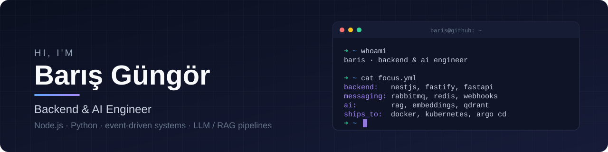
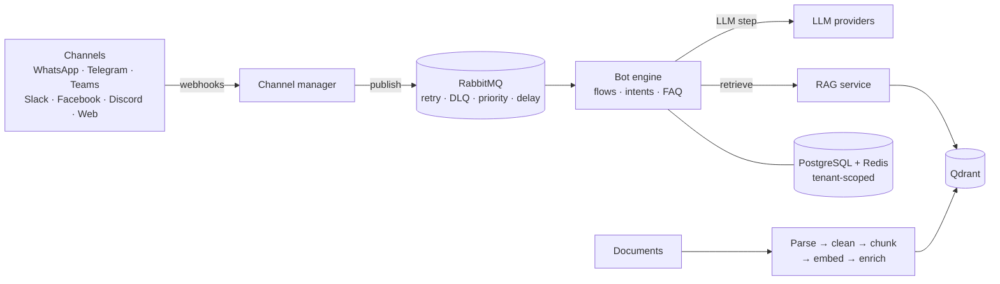

 

---

## 👋 About me

I build the parts of a product that users never see but always feel: the services that take messages from
six different channels and route them in order, the queues that retry what failed and park what cannot be
saved, and the pipelines that turn messy documents into something an LLM can actually answer from.

For about five years I have been working mostly on the backend side with **Node.js (NestJS)** and
**Python (FastAPI)**, on multi-tenant and event-driven systems that run in production, plus enough
**Vue.js** to ship the screens on top of them. Lately most of my time goes into **LLM and RAG** work:
parsing, chunking, embeddings, vector search and wiring several model providers behind one interface.

## 🧭 What I work on

<table>
  <tr>
    <td width="50%" valign="top">

### 🏗️ Multi-tenant backends

Tenant-isolated environments, tenant-scoped caching, configuration that can be moved between tenants and
collections, REST APIs with versioning and OpenAPI docs. Authentication with JWT and refresh tokens,
authorization with attribute-based rules (CASL).

</td>
    <td width="50%" valign="top">

### 💬 Conversational & messaging systems

A unified messaging layer for WhatsApp, Telegram, MS Teams, Slack, Facebook and Discord. Webhook ingestion,
asynchronous processing, intent / entity / FAQ management, LLM-powered flow steps, speech-to-text and
text-to-speech, at loads of a few thousand conversations a day.

</td>
  </tr>
  <tr>
    <td width="50%" valign="top">

### 🧠 LLM & RAG pipelines

Document parsing that reads structure (headings, font sizes), semantic, recursive and size-based chunking,
embedding and enrichment steps (including LLM-based table enrichment), similarity search tuning in
**Qdrant**, and a provider layer over OpenAI, Anthropic, Google, Hugging Face and others.

</td>
    <td width="50%" valign="top">

### 📨 Event-driven architecture

**RabbitMQ** with retries, dead-letter, priority and delayed queues; in-process domain events in modular
monoliths; scheduled jobs, backup / restore and real-time analytics. I like systems where every message
has a known path, including the failure path.

</td>
  </tr>
  <tr>
    <td width="50%" valign="top">

### 📄 OCR & document intelligence

OCR on scanned PDFs (Tesseract, OCRmyPDF) with rule-based segmentation, so documents with many unrelated
records on one page can be split, filtered and handed to an LLM for structured extraction.

</td>
    <td width="50%" valign="top">

### 🚢 Delivery & quality

Unit, integration and end-to-end tests (Jest, Vitest, tests against a real PostgreSQL), raising coverage on
legacy code to 80%, refactoring old codebases, and CI/CD with Jenkins and Argo CD onto Kubernetes.

</td>
  </tr>
</table>

### A typical system I work on

## 🛠️ Tech stack

| Area | Tools |
|---|---|
| **Languages** |    |
| **Backend** |       |
| **AI / LLM** |       |
| **Data & messaging** |      |
| **DevOps** |      |
| **Testing** |    |
| **Frontend** |      |
| **Ways of working** |   

## 🚀 Featured projects

<table>
  <tr>
    <td width="50%" valign="top">

### [📈 backtrail](https://github.com/baris-gungor/backtrail)

**Does what I tested match what actually happens?** A trading-strategy research platform: hourly market data,
11 indicators feeding rule-based strategies, an event-driven backtest engine with fees, slippage,
**walk-forward** and **Monte Carlo** analysis, and paper portfolios (internal and Alpaca paper).

The backtest and the paper portfolio share one execution engine, so a divergence report can prove the two
produce identical trades. Modular monolith with pure domain layers, ports and adapters, `decimal.js` for
money, end-to-end tests against a real PostgreSQL, and a bilingual Vue 3 dashboard.

</td>
    <td width="50%" valign="top">

### [📄 doc-ocr-llm-analyzer](https://github.com/baris-gungor/doc-ocr-llm-analyzer)

Turns scanned Turkish trade-registry gazette PDFs into structured company data with one HTTP call: Turkish
OCR, rule-based splitting of the many announcements printed on one page, company filtering, heading-aware
chunking, then per-chunk LLM extraction rendered as an HTML report.

The LLM layer is one abstract base class with retries and exponential backoff on rate limits; Groq,
OpenRouter, Hugging Face and Together AI are thin subclasses chosen by a single environment variable.

</td>
  </tr>
</table>

## 🧩 How I like to build

- **One code path for the same decision.** If two features answer the same question, they should run the
  same code, so their results can be compared instead of argued about.
- **Plan for the failure path.** Retries, dead-letter queues, idempotent ids, kill switches and audit logs
  are part of the design, not an afterthought.
- **Keep the domain pure.** Business rules without framework imports, outside services behind ports, so the
  core is easy to test and easy to change.
- **Test against the real thing where it matters.** End-to-end tests on a real database, fakes only at the
  network edge.
- **Be honest about limits.** Every project README lists what it does not do yet.

---

Open to conversations about backend architecture, messaging systems and LLM / RAG work.

